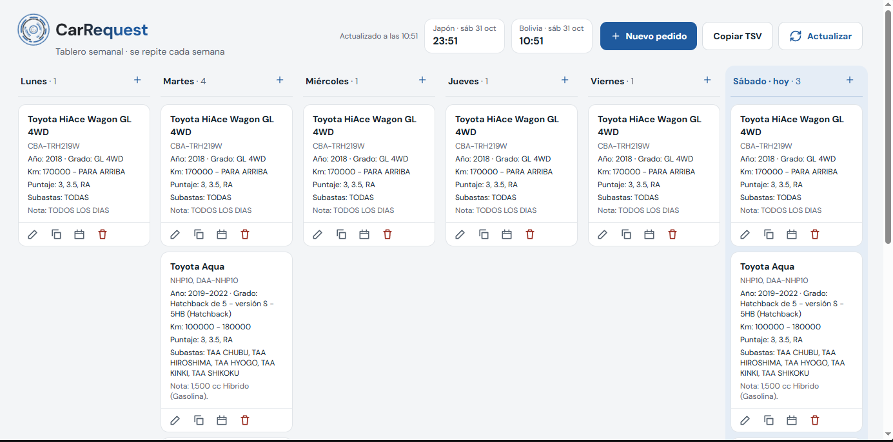
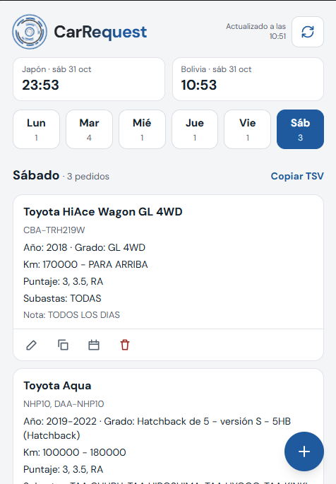

<div align="center">

# CarsRequest

**Tablero semanal para organizar pedidos de vehículos de subastas japonesas.**


</div>

---

## Qué es

CarsRequest reemplaza el desorden de los mensajes de WhatsApp. Quien hace los pedidos los ordena por día de la semana, con un campo para cada dato, y quien los busca en las subastas los ve de un vistazo.

- **Semana tipo que se repite:** de lunes a sábado, sin fechas. Lo que se busca el lunes se busca todos los lunes.
- **Mobile first:** pensado para usarse sobre todo desde el móvil, con vista de escritorio en 6 columnas.
- **Sin servidor propio:** los datos viven en una hoja de Google Sheets y se leen y escriben con Google Apps Script.
- **Instalable:** funciona como PWA.

## Capturas

| Escritorio | Móvil |
| :---: | :---: |
|  |  |

## Características

- Un formulario con un campo por dato, todos opcionales: Modelo, Subasta, Chasis, Año, Grado, Km, Color, Puntaje, Precio y Nota.
- No se guarda un pedido vacío.
- **Varios modelos en un pedido:** el botón `+` junto a Modelo agrega otra caja (máx. 10). La tarjeta los muestra uno debajo de otro.
- **Varias subastas:** el botón `+` de Subasta las guarda juntas, separadas por coma.
- **Todos los días:** al crear un pedido se puede agregar a los 6 días en una sola petición.
- **Acciones por tarjeta:** editar, copiar a otro día, copiar a toda la semana y eliminar, con confirmación en las acciones destructivas.
- **Etiqueta verde "Nuevo"** en los pedidos agregados (o modificados) hace menos de una hora.
- **Copiar TSV** del día o de la semana, listo para pegar en Sheets.
- Relojes de **Japón** y **Bolivia**. El día marcado como "hoy" sigue la hora de Japón.
- Actualización **manual**: la app lee la hoja al abrirse y al pulsar Actualizar. No hay polling.

## Stack

| Capa | Tecnología |
| --- | --- |
| Interfaz | React 18 + TypeScript (strict) |
| Estilos | Tailwind CSS 3, fuente DM Sans autoalojada (`@fontsource/dm-sans`) |
| Empaquetado | Vite 5 |
| PWA | `vite-plugin-pwa` |
| Datos | Google Sheets + Google Apps Script |

Sin librería de estado, sin librería de rutas y sin servicios de terceros.

## Estructura

```
apps-script/Code.gs      API de Apps Script (respaldo del script de la hoja)
public/                  Iconos de la PWA
src/
  App.tsx                Token, pantalla principal, acciones y modales
  storage.ts             Único acceso a datos (token, caché, API)
  types.ts, util.ts      Tipos, días, relojes, TSV
  components/            Cabecera, Tablero, VistaDia, Tarjeta, Formulario, ...
```

## Puesta en marcha

### 1. Hoja y API (Apps Script)

1. Crea una hoja de Google Sheets nueva.
2. Abre **Extensiones > Apps Script** y pega el contenido de [`apps-script/Code.gs`](apps-script/Code.gs).
3. Ejecuta `setup()` una vez. Crea la hoja `Pedidos` y genera el **token** (míralo en *Ver > Registros de ejecución*).
4. **Implementar > Nueva implementación > Aplicación web**, ejecutar como *Yo* y acceso para *Cualquier persona*. Copia la URL que termina en `/exec`.
5. Si cambias el script, crea una **versión nueva** de la implementación. La URL se mantiene.

### 2. Aplicación

```bash
npm install
cp .env.example .env.local   # pon aquí VITE_API_URL con la URL /exec
npm run dev
```

Abre `http://localhost:5173/?token=EL_TOKEN` la primera vez. El token se guarda en el navegador y se quita de la barra de direcciones.

Para compilar: `npm run build` (ejecuta `tsc` y luego Vite).

## Modelo de datos

Hoja `Pedidos`:

```
id | dia | modelo | subasta | chasis | anio | grado | km | color | puntaje | precio | nota | orden | actualizado
```

- `dia`: `lunes`, `martes`, `miercoles`, `jueves`, `viernes` o `sabado` (sin tildes).
- Todo se guarda como texto.
- Varios modelos van en la misma celda, separados por salto de línea.
- Varios valores en un campo: coma y espacio (`3, 3.5, 4`). Rangos: `80000 - 90000`. Decimales con punto.

## API

Todas las peticiones llevan el token. Las lecturas son `GET ?token=T`. Las escrituras son `POST` con cuerpo JSON y `Content-Type: text/plain`, para evitar el preflight de CORS.

| Acción | Descripción |
| --- | --- |
| `crear` | Crea un pedido en un día |
| `editar` | Cambia campos y, opcionalmente, el día |
| `eliminar` | Borra un pedido |
| `copiar` | Copia un pedido a los días indicados |
| `copiarSemana` | Copia un pedido a los demás días |
| `crearVarios` | Crea varios pedidos en varios días (máx. 20 items) |

Toda escritura responde `{ ok, version, resultado, items }` con el tablero actualizado.

## Despliegue

Es una app estática: sirve en Vercel, Cloudflare Pages o GitHub Pages. Define la variable de entorno `VITE_API_URL` con la URL de Apps Script.

## Seguridad

El token no está en el código. Cada persona lo guarda en su navegador. Si el servidor responde "No autorizado", la app lo borra y lo pide de nuevo. `.env.local` no se sube al repositorio.
